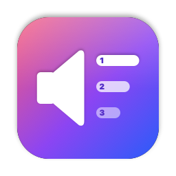

<p align="center">
  
</p>

<h1 align="center">Audio-Prioritäten</h1>

<p align="center">
  Kleine macOS-Menüleisten-App, die deine Audioausgabe nach einer festen Rangliste wählt.<br>
  Ist das bevorzugte Gerät nicht da, nimmt sie automatisch das nächste.
</p>

<p align="center">
  <a href="https://ko-fi.com/mbmf17"></a>
</p>

---

## Warum?

macOS schaltet beim Anstecken eines Geräts oft auf irgendetwas um – Monitor-Lautsprecher, USB-Dongle, Kopfhörer.
Mit Audio-Prioritäten legst du **einmal** fest, was du bevorzugst, und die App sorgt dafür, dass es so bleibt.

Beispiel:

1. USB-Headset → wenn eingesteckt, immer das
2. Externe Boxen am Audio-Interface
3. Monitor-Lautsprecher
4. Eingebaute Lautsprecher → Rückfallebene

<!-- TODO: Screenshot einfügen, z. B. Docs/screenshot.png -->

## Funktionen

- **Drag & Drop**: alle erkannten Ausgabegeräte in die gewünschte Reihenfolge ziehen
- **Automatisches Umschalten** beim An- und Abstecken (inkl. Bluetooth)
- **Merkt sich auch getrennte Geräte** – sie behalten ihren Platz in der Liste
- **Geräte ausschließen**, die nie automatisch gewählt werden sollen (z. B. virtuelle Geräte)
- **Systemtöne** (Hinweise, Effekte) optional mit umleiten
- **Schnellwahl** über das Menüleisten-Symbol
- **Start bei Anmeldung**
- Kein Tracking, keine Netzwerkzugriffe, keine Abhängigkeiten – nur Apple-Frameworks

## Installation

1. Neuesten Installer (`AudioPriority-x.y.pkg`) unter **Releases** herunterladen.
2. Die App ist nicht von Apple beglaubigt (kein kostenpflichtiges Entwicklerkonto). Beim ersten Öffnen daher:
   **Rechtsklick auf die .pkg → Öffnen → Öffnen** bestätigen.
   Alternativ: *Systemeinstellungen → Datenschutz & Sicherheit → „Dennoch öffnen“*.
3. Installer durchklicken – die App startet danach automatisch und erscheint in der Menüleiste.
4. Im Fenster *„Prioritäten bearbeiten …“* die Reihenfolge festlegen und *„Beim Anmelden starten“* aktivieren.

Voraussetzung: macOS 13 Ventura oder neuer, Apple Silicon oder Intel.

### Deinstallieren

App beenden und `/Programme/AudioPriority.app` in den Papierkorb legen – oder `Installer/uninstall.sh` ausführen (entfernt auch die Einstellungen).

## Selbst bauen

Benötigt nur die Xcode Command Line Tools (`xcode-select --install`).

```bash
./build.sh                               # -> build/AudioPriority.app
VERSION=1.2 Installer/make_installer.sh  # -> dist/AudioPriority-1.2.pkg
```

### Aufbau

| Datei | Inhalt |
|---|---|
| `Sources/AudioPriority/CoreAudioHelper.swift` | Zugriff auf CoreAudio: Geräte, Standardausgabe, Listener |
| `Sources/AudioPriority/PriorityStore.swift` | Prioritätenliste, Speicherung, Umschaltlogik |
| `Sources/AudioPriority/AudioPriorityApp.swift` | SwiftUI-Fenster und Menüleisten-Menü |
| `Sources/AudioPriority/MenuBarIcon.swift` | Menüleisten-Symbol |
| `Sources/AudioPriority/Links.swift` | Spenden-/Projekt-Links, „Über“-Fenster |
| `Tools/make_icon.swift` | erzeugt das App-Icon |
| `Installer/` | pkg-Installer und Deinstallations-Skript |

## Unterstützen

Die App ist kostenlos und bleibt es. Wenn sie dir nützt, freue ich mich über einen Kaffee auf
**[Ko-fi](https://ko-fi.com/mbmf17)** ☕ – das hilft z. B., irgendwann ein Apple-Entwicklerkonto
zu finanzieren, damit die Sicherheitswarnung beim Installieren entfällt.

Fehler gefunden oder Idee? Gerne als Issue melden.

## English

**Audio-Prioritäten** is a tiny macOS menu bar app that picks your audio output from a ranked list:
if the top device isn't connected, the next available one is used. Drag & drop ordering, auto-switching
on connect/disconnect, excluded devices, optional system-sound routing, launch at login.
Download the `.pkg` from Releases (right-click → Open on first launch, as it isn't notarized).
Free and MIT-licensed – [buy me a coffee on Ko-fi](https://ko-fi.com/mbmf17) if you like it.

## Lizenz

[MIT](LICENSE)
