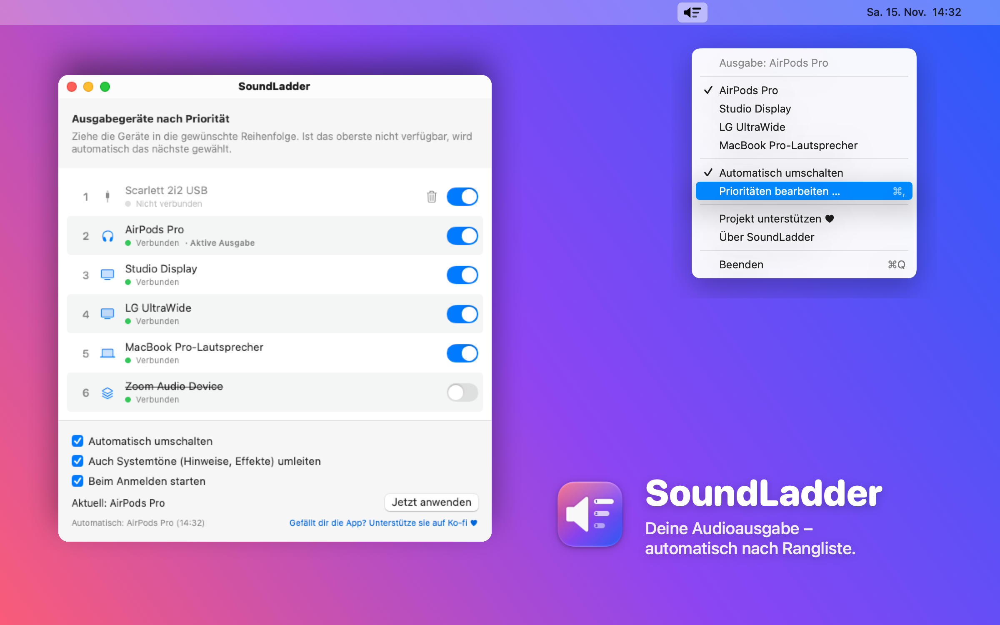

<p align="center">
  
</p>

<h1 align="center">SoundLadder</h1>

<p align="center">
  A tiny macOS menu bar app that picks your audio output from a ranked list.<br>
  If your favourite device isn't connected, the next one takes over – automatically.
</p>

<p align="center">
  <a href="https://github.com/dirkkredinger/SoundLadder/releases/latest"></a>
  
  
  <a href="https://ko-fi.com/mbmf17"></a>
</p>

<p align="center">
  
</p>

<p align="center"><i>🇩🇪 Deutsche Beschreibung <a href="#deutsch">weiter unten</a>.</i></p>

---

## Why?

macOS likes to switch your sound to whatever was plugged in last – monitor speakers, a USB dongle, the dock.
With SoundLadder you decide **once** what you prefer, and the app keeps it that way.

Example ladder:

1. USB headset → always this one when it's plugged in
2. AirPods
3. Speakers on the audio interface
4. Built-in speakers → fallback

## Features

- **Drag & drop** all detected output devices into your preferred order
- **Automatic switching** when devices connect or disconnect (incl. Bluetooth)
- **Remembers disconnected devices** – they keep their place in the ladder
- **Exclude devices** that should never be picked automatically (e.g. virtual devices)
- Optionally route **system sounds** (alerts, effects) as well
- **Quick switch** from the menu bar icon
- **Launch at login**
- English and German interface
- No tracking, no network access, no dependencies – just Apple frameworks

## Installation

### Homebrew

```bash
brew tap dirkkredinger/tap
brew trust dirkkredinger/tap      # Homebrew 7+ asks you to trust third-party taps
brew install --cask soundladder
```

### Installer

1. Download `SoundLadder-x.y.pkg` from the [latest release](https://github.com/dirkkredinger/SoundLadder/releases/latest).
2. SoundLadder is not notarized by Apple (no paid developer account – yet 😉), so macOS will block it the first time:
   open **System Settings → Privacy & Security**, scroll down and click **“Open Anyway”** next to the SoundLadder message.
3. Click through the installer – the app starts automatically and appears in your menu bar.
4. Open *“Edit priorities…”*, arrange your devices and turn on *“Launch at login”*.

Requires macOS 13 Ventura or later, Apple silicon or Intel.

### Uninstall

Quit the app and move `/Applications/SoundLadder.app` to the Trash – or run `Installer/uninstall.sh` (also removes settings).
With Homebrew: `brew uninstall --cask soundladder`.

## Build it yourself

Only the Xcode Command Line Tools are needed (`xcode-select --install`).

```bash
./build.sh                               # -> build/SoundLadder.app
VERSION=1.3 Installer/make_installer.sh  # -> dist/SoundLadder-1.3.pkg

# Re-create the promo images (demo data, your real settings stay untouched)
build/SoundLadder.app/Contents/MacOS/SoundLadder --screenshot Docs/screenshot.png -AppleLanguages "(en)"
build/SoundLadder.app/Contents/MacOS/SoundLadder --screenshot Docs/screenshot-de.png -AppleLanguages "(de)"
```

| File | Purpose |
|---|---|
| `Sources/SoundLadder/CoreAudioHelper.swift` | CoreAudio access: devices, default output, listeners |
| `Sources/SoundLadder/PriorityStore.swift` | Priority list, persistence, switching logic |
| `Sources/SoundLadder/SoundLadderApp.swift` | SwiftUI window and menu bar menu |
| `Sources/SoundLadder/MenuBarIcon.swift` | Menu bar icon |
| `Sources/SoundLadder/Links.swift` | Donation/project links, About panel |
| `Sources/SoundLadder/Screenshot.swift` | Renders the promo images in demo mode |
| `Resources/*.lproj` | Translations (English is the base language) |
| `Tools/make_icon.swift` | Generates the app icon |
| `Installer/` | pkg installer and uninstall script |

## Support

SoundLadder is free and will stay free. If it saves you some annoyance, a coffee on
**[Ko-fi](https://ko-fi.com/mbmf17)** ☕ is much appreciated – it might one day pay for an Apple developer account,
so the security warning during installation goes away.

Found a bug or have an idea? Please open an issue.

## Credits

Built by Dirk Kredinger with the help of [Claude](https://claude.ai) by Anthropic.

## License

[MIT](LICENSE)

---

## Deutsch

<p align="center">
  
</p>

**SoundLadder** ist eine kleine macOS-Menüleisten-App, die deine Audioausgabe nach einer festen Rangliste wählt.
Ist das bevorzugte Gerät nicht angeschlossen, wird automatisch das nächste verwendet. Die Oberfläche erscheint
auf Deutsch, wenn macOS auf Deutsch eingestellt ist.

**Funktionen:** Geräte per Drag & Drop sortieren · automatisches Umschalten beim An- und Abstecken ·
getrennte Geräte behalten ihren Platz · Geräte von der Automatik ausschließen · Systemtöne optional mit umleiten ·
Schnellwahl in der Menüleiste · Start bei Anmeldung.

**Installation:**

1. `SoundLadder-x.y.pkg` aus dem [neuesten Release](https://github.com/dirkkredinger/SoundLadder/releases/latest) laden
   – oder per Homebrew: `brew tap dirkkredinger/tap && brew trust dirkkredinger/tap && brew install --cask soundladder`.
2. Die App ist nicht von Apple beglaubigt. macOS blockiert sie daher beim ersten Öffnen:
   **Systemeinstellungen → Datenschutz & Sicherheit** öffnen, nach unten scrollen und bei SoundLadder **„Dennoch öffnen“** klicken.
3. Installer durchklicken – die App startet und erscheint in der Menüleiste.
4. Unter *„Prioritäten bearbeiten …“* die Reihenfolge festlegen und *„Beim Anmelden starten“* aktivieren.

Voraussetzung: macOS 13 Ventura oder neuer.

**Unterstützen:** Die App ist kostenlos. Wenn sie dir nützt, freue ich mich über einen Kaffee auf
[Ko-fi](https://ko-fi.com/mbmf17) ☕.

**Entstehung:** SoundLadder wurde von Dirk Kredinger mit Hilfe von [Claude](https://claude.ai) (Anthropic) entwickelt.
